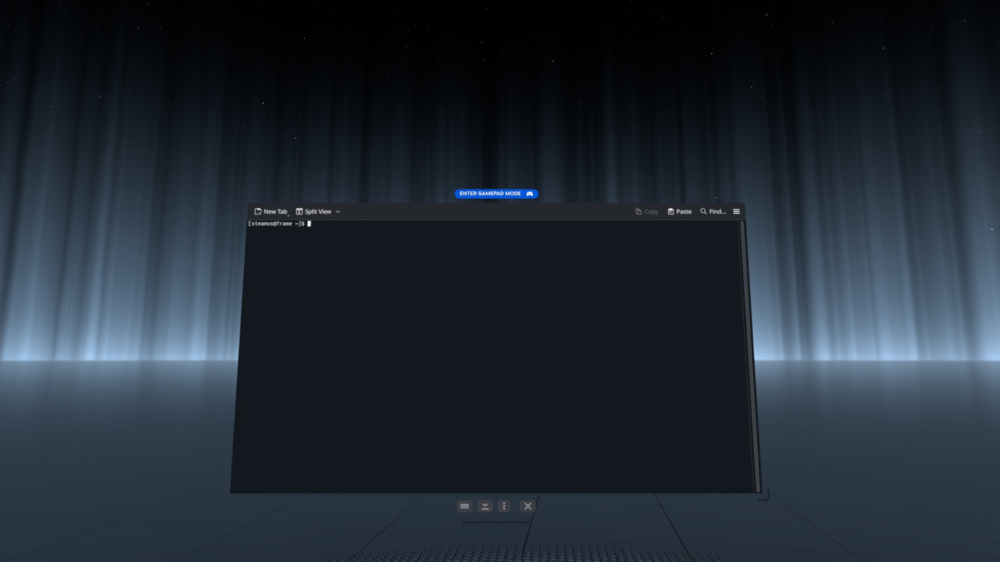

# Steam Frame Clean Resume (No dashboard on resume)

You’re in your relaxing environment of choice. You need to get up and do something, so you press **Power** to put your Steam Frame to sleep (suspend). When you come back and wake it, the first thing you see is the dashboard.

I don’t want to come back to a menu. I want to be right back in the nice chill environment where I left off.

**Steam Frame Clean Resume** takes you straight back to your running environment when you wake, with the dashboard closed. The **Steam button** still brings up the dashboard whenever you want it.

**Theater mode and floating windows are not affected.** If you put the Frame to sleep while playing a game in theater mode, your theater screen and floating windows are still there, ready to go when you resume. It only closes the dashboard. It does not close your game, theater mode or floating windows.

Unofficial installer for keeping the SteamVR dashboard closed on resume. *Created with AI assistance*

## Install

1. On your **Frame**, select [**Download Steam-Frame-Resume-Install.run**](https://github.com/Puffy288/steam-frame-clean-resume/releases/download/v0.1.0/Steam-Frame-Resume-Install.run) and save it in **Downloads**.
2. Open **Konsole**, then copy and paste this whole command:

```bash
bash ~/Downloads/Steam-Frame-Resume-Install.run
```

3. Select **Enter** on the on-screen keyboard. Wait for **Installed**. You can close Konsole afterwards.

Running setup again updates the same helper without creating duplicates. No administrator password is needed.

### Never used Desktop or Konsole on Frame?

With the default Frame controls, point and pull the **trigger** to select. Press the **thumbstick inward** for the context menu, then select an item with the trigger.

1. Press the controller’s **Steam button**, then select **+ (Launch Program) → Desktop** in the dashboard dock.
2. Open the desktop’s **application menu at the bottom left**, search for **Konsole** (with a **K**) and select it. Use the VR window’s **keyboard button** for the on-screen keys, selecting them with the trigger.
3. In this guide, hold the trigger and drag across the whole command to select it. Release the trigger, press the thumbstick inward over the selection, then select **Copy**.
4. Select the dark area in Konsole with the trigger, press the thumbstick inward, and select **Paste**. Open the window’s on-screen keyboard and select **Enter**.



The keyboard button is below the window, on the left of its small control bar.

Reading on another device? Open this guide and download the installer on your Frame. Find **Chromium**, the web browser, in the same desktop application menu. If it offers **Install Chromium**, select that first and follow its Install button.

## Confirm it worked

Leave your VR environment or game running. Press **Power** to suspend, then wake normally. You return to your running environment with the dashboard closed. If you were playing in theater mode or using floating windows, they remain in place. Afterwards, press **Steam** and check that the dashboard opens and stays open until you close it.

## What it does

A small background helper waits for SteamOS’s resume event and sends SteamVR’s built-in dashboard-close request **once**. It does not poll or keep the headset awake. It leaves tracking, boundaries, graphics, game launching and Steam settings alone.

The installer and helper make **no internet requests or uploads** and need no administrator password or debugging mode. The installer is readable text containing all the code. It briefly reads the existing SteamVR log to check for dashboard use, without sending it anywhere.

<details>
<summary>Exactly where it installs</summary>

`~` means your home folder. Everything persistent goes inside it:

- `~/.local/share/frame-resume-dashboard/`: helper, uninstaller and ownership marker.
- `~/.config/systemd/user/frame-resume-dashboard.service`: startup service.
- `~/.config/systemd/user/default.target.wants/frame-resume-dashboard.service`: startup link.
- `~/.local/state/frame-resume-dashboard/previous-install/`: backup of the previous helper and service when reinstalling.

Setup removes its temporary `/tmp/frame-resume-dashboard.*` folder on exit. The downloaded installer stays in Downloads. Status messages go to the normal user service journal. No existing Steam configuration is edited, so none needs restoring.

</details>

## Uninstall

Copy this into Konsole using the same controller steps:

```bash
bash ~/.local/share/frame-resume-dashboard/uninstall.sh
```

Select **Enter** on the on-screen keyboard. This stops and removes the helper, service and startup link. Normal dashboard-on-resume behaviour returns. Previous-install backups and the downloaded installer remain as ordinary, inactive files. Delete them in the file manager if you want.

Tested with an actual suspend/resume cycle and normal Steam-button dashboard access on SteamOS 0.5.6, 19 October 2026. Reinstallation and uninstall were also verified.

Controller walkthrough and screenshot adapted from [SteamVR Home on Steam Frame](https://github.com/Puffy288/steamvr-home-frame/blob/main/START-HERE.md). Navigation checked against [Valve’s Frame guide](https://help.steampowered.com/en/faqs/view/2668-0B6E-79E0-A85B).
